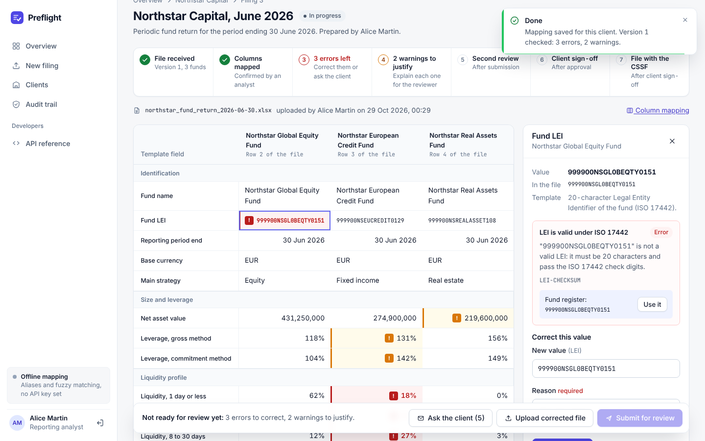

# Preflight

**Pre-submission checks for regulatory fund filings.** Every client sends fund data in its own format. Preflight maps it to the reporting template once, checks every value against the rules, keeps the client conversation traceable, requires a second person's approval and the client's sign-off, and records the filing with the regulator.



## The problem

Firms that file regulatory reports for fund managers, as a managed service or in-house, receive the underlying data from each client in a different spreadsheet: their own column names, English or French headers, amounts in euros or thousands, percentages as 12.5 or 0.125. Before any check can run, an analyst translates each file by hand, every period, for every client. Errors are found late, clients are chased by scattered emails, and it is hard to show afterwards who checked what.

## How it works

1. **Intake.** The analyst uploads the client's Excel or CSV file. It is fingerprinted (SHA-256) and logged.
2. **Column mapping.** Columns this client used before are recognised automatically. New columns get a proposal (field, unit conversion, confidence, reason) from Claude, or from an offline matcher when no API key is set. An analyst confirms it, and it is saved for next time.
3. **Normalisation and checks.** Plain code, no AI: dates, number formats and units are normalised, then 17 rules run (LEI check digits, totals, consistency, period-on-period changes). Each finding comes with an explanation.
4. **Resolution.** The analyst corrects obvious issues with a written reason, sends the client one grouped list of questions, uploads the corrected file (changes are highlighted), and justifies warnings.
5. **Four-eyes sign-off.** Submission is blocked until there are no errors and every warning is justified. Nobody who prepared the filing can approve it.
6. **Client sign-off.** The approved return goes back to the asset manager, which remains responsible for its regulatory reports. The analyst records the client's approval, or its change request, which sends the filing back through the four-eyes review.
7. **Filing.** The filing-ready CSV is submitted through the regulator's official channel (the CSSF in the demo), and the submission reference is recorded. A printable validation record covers every step, built from the hash-chained audit trail.

**Design principle:** the AI only proposes column mappings; people confirm them, and deterministic rules decide what is right.

## Demo in two minutes

```bash
pip install -r requirements-dev.txt
uvicorn app.main:app --reload        # http://localhost:8000 (database is created and seeded on start)
```

Sign in with the one-click demo accounts (password `demo1234`).

1. **Alice Martin**, *New filing*, *Use a demo file*, *Northstar, June 2026*. A new client: review the proposed mapping (note "(EUR k)" detected as thousands) and confirm.
2. The grid shows **3 errors and 2 warnings**. Click the red LEI cell: the check digits fail, and the fund register suggests the right LEI. Use it, with a reason.
3. **Ask the client**: one grouped message to Northstar. Record it as sent, then **Upload corrected file**, *Use the demo reply*. Two values changed, errors are gone, the LEI correction is kept.
4. Justify the two warnings, **Submit for review**. Alice cannot approve her own work.
5. Sign in as **Claire Dubois**: approve.
6. Back as Alice: **Send to client for sign-off**, then **Record client answer** (approved by Laura Weiss), then **Record CSSF submission** with a reference. All seven checklist steps are complete; open the validation record.
7. Upload **Northstar, September 2026**: no mapping step, every rule passes. That is the time saved every quarter.

Riverbend Gestion (a French client with decimal commas and liquidity as fractions) comes pre-seeded with a March filing already filed and a June filing waiting in Claire's review queue.

## What is in the code

| Area | Implementation |
|---|---|
| Python automation | Intake, mapping, normalisation and validation pipeline in `app/services/` |
| FastAPI | Server-rendered UI and a JSON API (`/docs`): token auth, upload, mapping, submit, approve, return |
| Auth | JWT in an HttpOnly cookie (UI) or Bearer header (API); maker, checker and admin roles. `security.py` is the plug-in point for SSO (OpenID Connect) |
| SQL and data model | SQLAlchemy 2: clients, fund registers, filings, file versions, findings, corrections, client queries, learned mappings, audit log |
| Regulatory rules | `app/template_defs/fund_return_v1.yaml`: fields, aliases, rules, explanations and client questions as reviewable configuration ([spec](docs/SPEC.md)) |
| AI | Claude tool use with a forced schema; every proposal validated; offline fallback so the workflow never depends on the AI service |
| Controls | Four-eyes enforced in the service layer, mandatory reasons, hash-chained audit trail |
| Quality | 65 tests (rules, parsing, mapping, workflow, API, pages), ruff, GitHub Actions on Python 3.11 to 3.13 |

## Enable Claude for column mapping

```bash
cp .env.example .env    # set ANTHROPIC_API_KEY
```

## Deploy

```bash
docker build -t preflight . && docker run -p 8000:8000 -e SECRET_KEY=change-me preflight
```

Runs as-is on Render, Railway or Fly.io. For production use PostgreSQL (`DATABASE_URL`), a strong `SECRET_KEY` and `COOKIE_SECURE=true`.

## Limits

- The template is a small demonstration slice (16 fields, 17 rules) inspired by periodic fund reporting. It is not an official regulatory template. Preflight records the submission to the regulator but does not perform it, and clients answer by email (recorded by the analyst) rather than through a portal.
- All clients, funds and figures are fictional; LEIs use the unallocated prefix 999900.
- Next steps: official template schemas (XML), SSO, a client portal for uploads and sign-off, connection to the submission channel, bulk processing across clients.

## How AI coding assistants were used

AI assistants helped write parts of this project. The behaviour that matters (rule logic, parsing edge cases, four-eyes controls, audit chain) is pinned by tests written against the specification in `docs/SPEC.md`.
